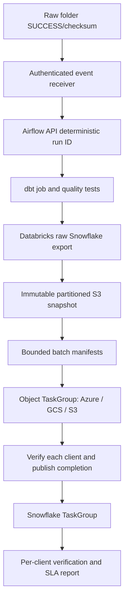
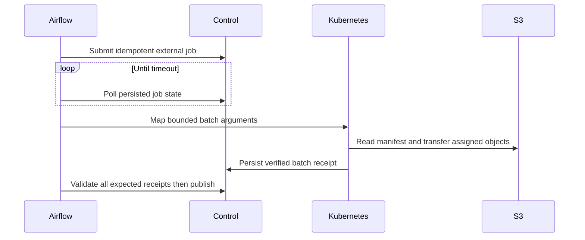

# Architecture

Actual DAG object phase demonstrates S3; Azure/GCS adapters deliberately fail closed until implemented. The control plane and worker entry point are documented integration contracts, not an implemented service. Partition discovery and verification helpers are real example logic. Mapping completion forms a conservative global barrier; per-client finalizers are a production improvement to reduce unrelated blocking.
